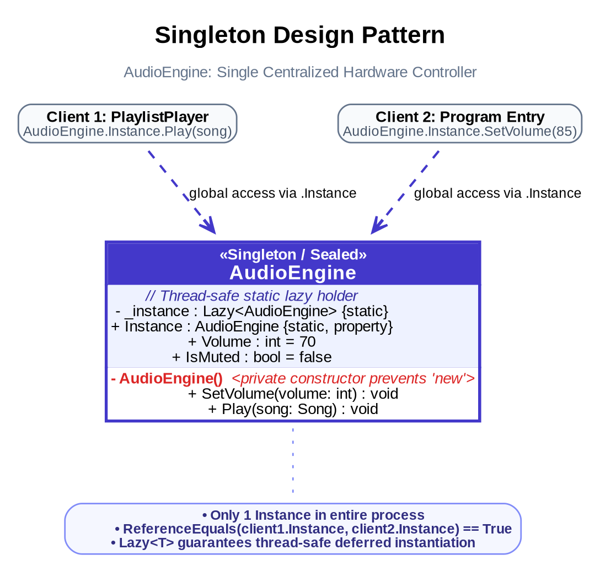
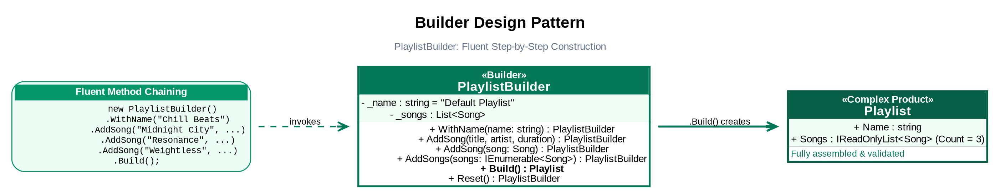
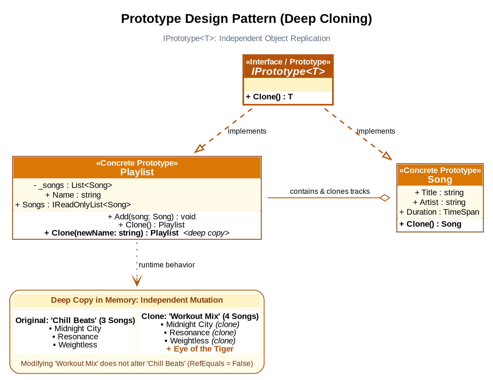

# Music Player & Playlist System — Creational Design Patterns

**Laboratory Work 2**  
*Course: Techniques and Mechanisms of Software Design (TMPS)*  
*Author: Pavlov Iulian, Group FAF-241*

---

## Table of Contents

- [Introduction](#introduction)
- [Objectives](#objectives)
- [Implemented Creational Design Patterns](#implemented-creational-design-patterns)
  - [1. Singleton Pattern (`AudioEngine`)](#1-singleton-pattern-audioengine)
  - [2. Builder Pattern (`PlaylistBuilder`)](#2-builder-pattern-playlistbuilder)
  - [3. Prototype Pattern (`IPrototype<T>`)](#3-prototype-pattern-iprototypet)
- [Theoretical Overview of Additional Creational Patterns](#theoretical-overview-of-additional-creational-patterns)
  - [Factory Method](#factory-method)
  - [Abstract Factory](#abstract-factory)
  - [Object Pooling](#object-pooling)
  - [Patterns Summary Matrix](#patterns-summary-matrix)
- [Conclusion](#conclusion)
- [Author](#author)

---

## Introduction

In software architecture, **Creational Design Patterns** abstract the object instantiation process. They decouple the client code from concrete object creation, construction logic, and representation choices.

For **Laboratory Work 2**, three creational patterns were selected and implemented within the **Music Player & Playlist Management System**:
1. **Singleton**: Encapsulates audio hardware output and master volume controls in a single, globally accessible instance (`AudioEngine`).
2. **Builder**: Provides a fluent, step-by-step construction API for creating complex playlists (`PlaylistBuilder`).
3. **Prototype**: Implements deep cloning for playlists and individual tracks via a generic abstraction (`IPrototype<T>`).

This report provides the technical design, UML diagrams, code implementations, execution outputs, and theoretical evaluation of the creational pattern family.

---

## Objectives

1. Select and implement at least **3 Creational Design Patterns** from the following list:
   - **Singleton** *(Implemented)*
   - **Builder** *(Implemented)*
   - **Prototype** *(Implemented)*
   - Factory Method
   - Abstract Factory
   - Object Pooling
2. Integrate each pattern cleanly into the music player domain without breaking existing contracts.
3. Design and display comprehensive UML architectural and interaction diagrams.
4. Provide theoretical context and practical domain mapping for all six patterns.

---

## Implemented Creational Design Patterns

### 1. Singleton Pattern (`AudioEngine`)

#### Motivation & Problem Solved
In audio playback architectures, access to the physical audio output device, sound driver buffer, and master hardware volume must be managed uniformly. If multiple components independently instantiate separate audio engines, setting the volume in one component would not affect the others, and simultaneous playback could cause channel contention.

The **Singleton Pattern** ensures that a class has only one instance and provides a global access point to it.



#### Implementation Highlights
- **File**: `Services/AudioEngine.cs`
- **Private Constructor**: Prevents instantiation via `new AudioEngine()`.
- **`sealed` Modifier**: Prevents subclassing and malicious derived instances.
- **Thread-Safe Lazy Initialization**: Uses .NET's `Lazy<T>` to defer instantiation until first access, ensuring thread safety without explicit locks.

```csharp
namespace MusicPlayer.Services;

public sealed class AudioEngine
{
    private static readonly Lazy<AudioEngine> _instance = 
        new(() => new AudioEngine());

    public static AudioEngine Instance => _instance.Value;

    public int Volume { get; set; } = 70;
    public bool IsMuted { get; set; } = false;

    // Private constructor guarantees that only one instance can ever exist.
    private AudioEngine() { }

    public void Play(Song song)
    {
        if (IsMuted)
        {
            Console.WriteLine($"[AudioEngine] (Muted) Skipping sound output for '{song.Title}'");
            return;
        }

        Console.WriteLine($"[AudioEngine] Outputting '{song.Title}' by {song.Artist} ({song.Duration:m\\:ss}) at Volume {Volume}%");
    }

    public void SetVolume(int volume)
    {
        Volume = Math.Clamp(volume, 0, 100);
        Console.WriteLine($"[AudioEngine] Master volume set to {Volume}%");
    }
}
```

#### Usage in Client Code:
```csharp
var engine1 = AudioEngine.Instance;
var engine2 = AudioEngine.Instance;

Console.WriteLine($"Are both references identical? {ReferenceEquals(engine1, engine2)}"); // Output: True
AudioEngine.Instance.SetVolume(85);
```

---

### 2. Builder Pattern (`PlaylistBuilder`)

#### Motivation & Problem Solved
Constructing playlists directly via constructors becomes rigid and error-prone as optional configuration grows (title, multiple songs, tags, genres, duration thresholds). Telescoping constructors (multiple overloaded constructors with many parameters) degrade readability and maintainability.

The **Builder Pattern** separates the step-by-step construction of a complex object from its final representation, providing a clear, fluent method-chaining API.



#### Implementation Highlights
- **File**: `Builders/PlaylistBuilder.cs`
- **Fluent Interface**: Methods like `WithName()`, `AddSong()`, and `AddSongs()` return `this` to allow seamless chaining.
- **Encapsulated Assembly**: Tracks are stored internally in a working list until `Build()` is called.
- **`Reset()` Capability**: Allows reusing the builder to create subsequent playlists.

```csharp
namespace MusicPlayer.Builders;

public class PlaylistBuilder
{
    private string _name = "Default Playlist";
    private readonly List<Song> _songs = new();

    public PlaylistBuilder WithName(string name)
    {
        _name = name;
        return this;
    }

    public PlaylistBuilder AddSong(string title, string artist, TimeSpan duration)
    {
        _songs.Add(new Song(title, artist, duration));
        return this;
    }

    public PlaylistBuilder AddSong(Song song)
    {
        _songs.Add(song);
        return this;
    }

    public PlaylistBuilder AddSongs(IEnumerable<Song> songs)
    {
        _songs.AddRange(songs);
        return this;
    }

    public Playlist Build()
    {
        var playlist = new Playlist(_name);
        foreach (var song in _songs)
        {
            playlist.Add(song);
        }
        return playlist;
    }

    public PlaylistBuilder Reset()
    {
        _name = "Default Playlist";
        _songs.Clear();
        return this;
    }
}
```

#### Usage in Client Code:
```csharp
var chillPlaylist = new PlaylistBuilder()
    .WithName("Chill Beats")
    .AddSong("Midnight City", "M83", TimeSpan.FromMinutes(4.05))
    .AddSong("Resonance", "HOME", TimeSpan.FromMinutes(3.53))
    .AddSong("Weightless", "Marconi Union", TimeSpan.FromMinutes(8.00))
    .Build();
```

---

### 3. Prototype Pattern (`IPrototype<T>`)

#### Motivation & Problem Solved
Users frequently create variations of an existing playlist (e.g., duplicating a *"Chill Beats"* playlist into a *"Workout Mix"* and adding high-tempo songs). Re-querying and manually adding each song again introduces boilerplate code and couples client logic to playlist population details.

The **Prototype Pattern** allows objects to clone themselves.



#### Deep Copy vs. Shallow Copy
- In a **shallow copy**, only collection references are copied. Mutating tracks in the cloned playlist would unintentionally modify tracks in the original playlist.
- In a **deep copy**, the container is duplicated and each constituent track is cloned independently. Our implementation guarantees **deep copying**.

#### Implementation Highlights
- **Files**: `Abstractions/IPrototype.cs`, `Models/Song.cs`, `Models/Playlist.cs`

```csharp
// 1. Prototype Abstraction
namespace MusicPlayer.Abstractions;

public interface IPrototype<T>
{
    T Clone();
}
```

```csharp
// 2. Cloneable Song Model
public class Song : IPrototype<Song>
{
    public string Title { get; }
    public string Artist { get; }
    public TimeSpan Duration { get; }

    public Song(string title, string artist, TimeSpan duration)
        => (Title, Artist, Duration) = (title, artist, duration);

    public Song Clone() => new(Title, Artist, Duration);
}
```

```csharp
// 3. Cloneable Playlist Model (Deep Copy)
public class Playlist : IEditablePlaylist, IPrototype<Playlist>
{
    private readonly List<Song> _songs = new();
    public string Name { get; set; }
    public IReadOnlyList<Song> Songs => _songs;

    public Playlist(string name) => Name = name;

    public void Add(Song song) => _songs.Add(song);
    public void Remove(Song song) => _songs.Remove(song);

    public Playlist Clone() => Clone($"{Name} (Copy)");

    public Playlist Clone(string newName)
    {
        var copy = new Playlist(newName);
        foreach (var song in _songs)
        {
            copy.Add(song.Clone()); // Deep copy of individual tracks
        }
        return copy;
    }
}
```

#### Usage in Client Code:
```csharp
// Deep clone existing playlist into a new workout mix
var workoutPlaylist = chillPlaylist.Clone("Workout Mix");

// Adding a track only modifies the clone; original remains untouched
workoutPlaylist.Add(new Song("Eye of the Tiger", "Survivor", TimeSpan.FromMinutes(4.08)));

Console.WriteLine($"Original Playlist: '{chillPlaylist.Name}' ({chillPlaylist.Songs.Count} tracks)");
Console.WriteLine($"Cloned Playlist:   '{workoutPlaylist.Name}' ({workoutPlaylist.Songs.Count} tracks)");
Console.WriteLine($"Are playlist references different? {!ReferenceEquals(chillPlaylist, workoutPlaylist)}");
```

---

## Theoretical Overview of Additional Creational Patterns

To provide a complete evaluation of all patterns in the laboratory curriculum, this section analyzes the remaining three patterns:

### Factory Method
- **Intent**: Defines an interface for creating an object, but lets subclasses decide which class to instantiate.
- **Application in Audio Systems**: An audio system supporting multiple media item types (`SongTrack`, `PodcastEpisode`, `RadioStream`) can define an abstract `AudioTrackCreator` with a factory method `public abstract AudioTrack CreateTrack()`. Concrete creators (`SongCreator`, `PodcastCreator`) instantiate specific product subclasses without coupling playback engines to concrete types.

### Abstract Factory
- **Intent**: Provides an interface for creating families of related or dependent objects without specifying their concrete classes.
- **Application in Audio Systems**: Cross-platform audio drivers require matching sets of output devices, audio decoders, and mixer units. An `IAudioPlatformFactory` can provide:
  - `WindowsAudioFactory` -> creates `WasapiOutput` & `MediaFoundationDecoder`.
  - `LinuxAudioFactory` -> creates `PulseAudioOutput` & `FfmpegDecoder`.
  - `MacOSAudioFactory` -> creates `CoreAudioOutput` & `AudioToolboxDecoder`.
  This guarantees that mismatched drivers and decoders are never mixed.

### Object Pooling
- **Intent**: Manages a reusable cache of pre-allocated objects to avoid the continuous creation and destruction overhead of expensive or high-frequency objects.
- **Application in Audio Systems**: In real-time digital signal processing (DSP), audio byte buffers (e.g., `byte[4096]`) are allocated and discarded dozens of times per second. Frequent allocations trigger intense Garbage Collection (GC) pressure, causing audio playback stutter. An `AudioBufferPool` pre-allocates a fixed set of buffers that are rented, processed, cleared, and returned to the pool.

---

### Patterns Summary Matrix

| Pattern | Category | Primary Intent | Solved Problem in Audio Domain | Implemented in Project |
| :--- | :--- | :--- | :--- | :---: |
| **Singleton** | Creational | Guarantee a single instance with global access | Prevent hardware channel contention and desynchronized volume controls | **Yes** (`AudioEngine`) |
| **Builder** | Creational | Step-by-step assembly of complex objects | Prevent telescoping constructors when configuring rich playlists | **Yes** (`PlaylistBuilder`) |
| **Prototype** | Creational | Create new objects by cloning an existing prototype | Fast playlist duplication without re-specifying or rebuilding all tracks | **Yes** (`IPrototype<T>`) |
| **Factory Method** | Creational | Delegate object instantiation to specialized subclasses | Decouple player from specific media formats (Songs vs Podcasts) | *Theoretical* |
| **Abstract Factory** | Creational | Produce entire families of compatible objects | Ensure compatible OS audio stacks (Linux vs Windows audio pipelines) | *Theoretical* |
| **Object Pooling** | Creational / Behavioral | Pre-allocate and recycle high-frequency objects | Eliminate Garbage Collection spikes from frequent audio stream byte buffers | *Theoretical* |

---

## Conclusion

Laboratory Work 2 demonstrated the practical value of **Creational Design Patterns** in engineering flexible, maintainable, and decoupled software:

1. **Singleton (`AudioEngine`)**: Ensured centralized control over audio hardware resources, preventing audio channel race conditions and desynchronized volume states while guaranteeing thread safety.
2. **Builder (`PlaylistBuilder`)**: Replaced cumbersome object constructors with an intuitive, readable fluent API, making playlist construction robust against future parameter expansion.
3. **Prototype (`IPrototype<T>`)**: Enabled deep cloning of playlists and tracks, giving clients the ability to branch and customize existing collections without coupling to concrete instantiation logic.

Integrating these patterns produced a system where object creation is clean, expressive, and properly separated from runtime business logic.

---

## Author

- **Pavlov Iulian**
- **Group FAF-241**
- **Laboratory Work 2** – *Techniques and Mechanisms of Software Design (TMPS)*
