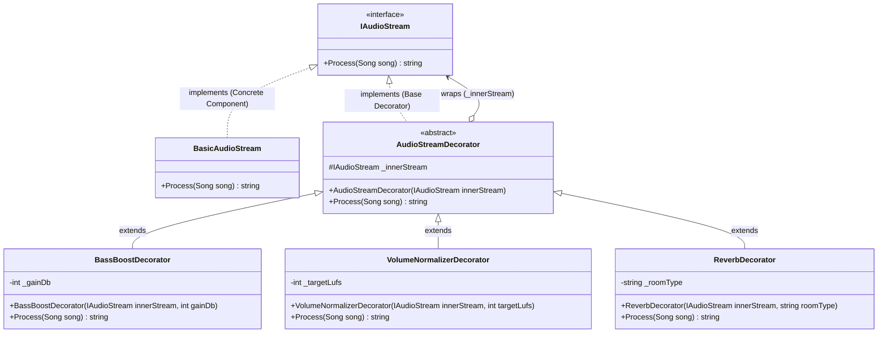
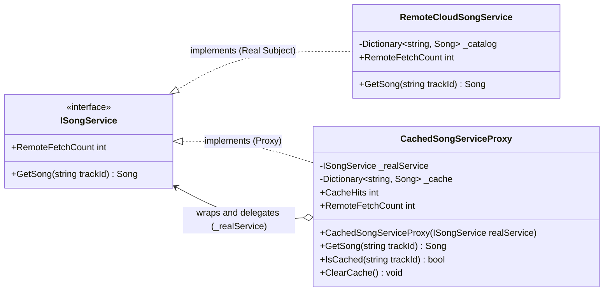
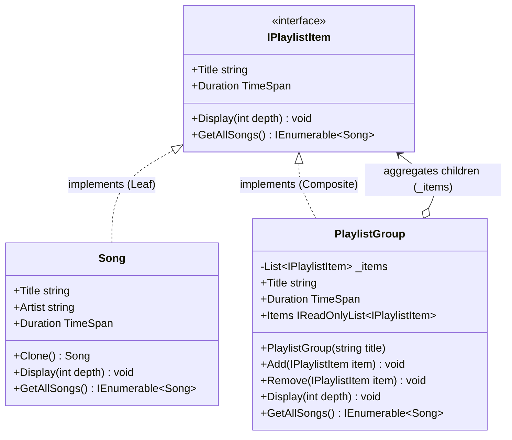
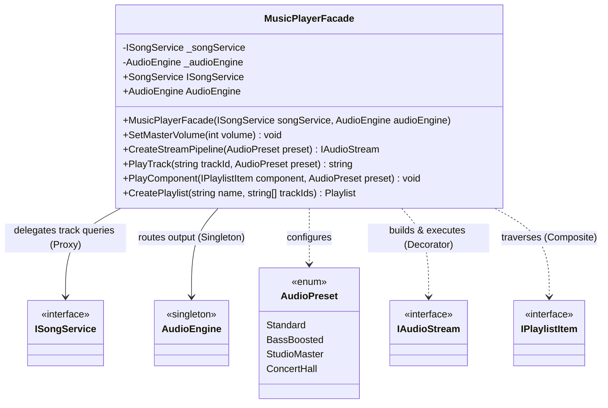

# Music Player & Playlist System — Structural Design Patterns

**Laboratory Work: Structural Design Patterns**  
*Course: Techniques and Mechanisms of Software Design (TMPS)*  
*Author: Pavlov Iulian, Group FAF-241*  
*Institution: Technical University of Moldova (UTM), FCIM / FAF*  

---

## Table of Contents

- [Introduction](#introduction)
- [Objectives](#objectives)
- [Domain Description](#domain-description)
- [Architectural Overview & Integration with Lab 1](#architectural-overview--integration-with-lab-1)
- [Implemented Structural Design Patterns](#implemented-structural-design-patterns)
  - [1. Decorator Pattern (`IAudioStream`)](#1-decorator-pattern-iaudiostream)
  - [2. Proxy Pattern (`ISongService`)](#2-proxy-pattern-isongservice)
  - [3. Composite Pattern (`IPlaylistItem`)](#3-composite-pattern-iplaylistitem)
  - [4. Facade Pattern (`MusicPlayerFacade`)](#4-facade-pattern-musicplayerfacade)
- [Pattern Interaction & Execution Path](#pattern-interaction--execution-path)
- [Theoretical Overview of Remaining Structural Patterns](#theoretical-overview-of-remaining-structural-patterns)
  - [Adapter Pattern](#adapter-pattern)
  - [Bridge Pattern](#bridge-pattern)
  - [Flyweight Pattern](#flyweight-pattern)
- [Structural Patterns Summary Matrix](#structural-patterns-summary-matrix)
- [Verification: Automated Unit Tests & Console Demo](#verification-automated-unit-tests--console-demo)
  - [Unit Test Results (xUnit)](#unit-test-results-xunit)
  - [Console Demonstration Output](#console-demonstration-output)
- [Conclusions](#conclusions)
  - [What Was Harder Than Expected](#what-was-harder-than-expected)
  - [What Would Be Designed Differently](#what-would-be-designed-differently)
- [Author](#author)

---

## Introduction

In software architecture, **Structural Design Patterns** focus on how classes and objects are composed to form larger, more flexible, and decoupled structures. While creational patterns govern instantiation and behavioral patterns govern object communication, structural patterns ensure that changes to one part of a system do not cascade into unintended breaking modifications across subsystems.

For this laboratory work, the **Music Player & Playlist Management System** developed in C# (.NET 10) was extended to incorporate four structural design patterns:
1. **Decorator**: Attaches digital signal processing (DSP) audio effects dynamically to streams at runtime.
2. **Proxy**: Provides transparent caching and access-control validation for remote cloud audio tracks.
3. **Composite**: Treats individual tracks (`Song`) and nested playlist containers (`PlaylistGroup`) uniformly through a common interface.
4. **Facade**: Coordinates all underlying subsystems (AudioEngine, Proxy, Composite, Decorator) through a simple, high-level client API.

---

## Objectives

1. **Understand and Implement Structural Patterns**: Implement at least **3 structural design patterns** with their full formal structures (interfaces, base classes, and concrete implementations).
2. **Pattern Interaction**: Ensure that at least one execution path passes across multiple structural patterns (`Client -> Facade -> Proxy -> Composite -> Decorator -> AudioEngine`).
3. **Depend on Abstractions**: Ensure client code interacts strictly with abstractions (`ISongService`, `IAudioStream`, `IPlaylistItem`), keeping concrete implementations encapsulated.
4. **Open for Extension (OCP)**: Verify that new variants (new audio decorators, new song providers, new playlist item types) can be introduced by adding new classes without modifying existing code.
5. **Build on Lab 1**: Extend the codebase from the creational patterns laboratory work, reusing `AudioEngine` (Singleton), `PlaylistBuilder` (Builder), and `Song.Clone()` (Prototype).
6. **Clean Architecture**: Organize the codebase into dedicated packages/namespaces (`Structural/Decorator`, `Structural/Proxy`, `Structural/Composite`, `Structural/Facade`).
7. **Comprehensive Verification**: Write unit tests proving the key properties of each pattern and provide a clear runnable demonstration.
8. **Theoretical Mastery**: Explain the intent, problem solved, and audio-domain application of the remaining structural patterns not directly chosen for implementation (Adapter, Bridge, Flyweight).

---

## Domain Description

The **Music Player & Playlist Management System** simulates a modern digital audio workstation (DAW) and streaming client:
- **Audio Output & Master Volume**: Centralized hardware output driver encapsulated by the `AudioEngine` singleton.
- **Track Assembly**: Fluent playlist construction handled by `PlaylistBuilder`.
- **Media Catalog**: Remote cloud song storage queried on demand, guarded and accelerated by caching proxies.
- **Audio Effects Pipeline**: Audio streams processed through dynamic filter chains (bass boost, loudness normalization, room acoustics).
- **Hierarchical Collections**: Music organized into nested folders, albums, and playlists containing tracks or sub-folders.
- **Client Playback Interface**: One-click simplified playback through a unified facade.

---

## Architectural Overview & Integration with Lab 1

The structural patterns directly leverage the creational patterns from Laboratory Work 1:
- **Singleton (`AudioEngine`)**: Reused as the terminal hardware sink where processed audio streams are delivered.
- **Builder (`PlaylistBuilder`)**: Reused by `MusicPlayerFacade.CreatePlaylist()` to assemble track collections retrieved from the proxy.
- **Prototype (`Song.Clone()`, `Playlist.Clone()`)**: Reused when duplicating playlist structures or creating independent audio processing snapshots.

---

## Implemented Structural Design Patterns

### 1. Decorator Pattern (`IAudioStream`)

#### Motivation & Problem Solved
Audio players frequently need to apply real-time sound effects (equalization, loudness normalization, room reverberation) to an audio stream. Creating a dedicated subclass for every potential permutation of effects (e.g., `BassBoostedStream`, `ReverbedStream`, `NormalizedBassBoostedReverbedStream`) triggers an exponential **class explosion** and statically locks the effect sequence at compile time.

The **Decorator Pattern** solves this problem by wrapping an audio stream inside decorator objects that share the exact same component interface (`IAudioStream`). Each decorator performs its DSP transformation and forwards the stream to the inner component, enabling arbitrary stacking orders at runtime.

#### Class Diagram



#### Implementation Highlights
- **Common Interface**: [`Structural/Decorator/IAudioStream.cs`](file:///home/sunflower/TMPS/Tmps/Structural/Decorator/IAudioStream.cs) defines `string Process(Song song);`.
- **Concrete Component**: [`Structural/Decorator/BasicAudioStream.cs`](file:///home/sunflower/TMPS/Tmps/Structural/Decorator/BasicAudioStream.cs) emits raw stereo PCM data.
- **Base Decorator**: [`Structural/Decorator/AudioStreamDecorator.cs`](file:///home/sunflower/TMPS/Tmps/Structural/Decorator/AudioStreamDecorator.cs) holds `protected readonly IAudioStream _innerStream` and provides default pass-through forwarding.
- **Concrete Decorators**:
  - [`BassBoostDecorator.cs`](file:///home/sunflower/TMPS/Tmps/Structural/Decorator/BassBoostDecorator.cs): Injects low-frequency equalization gain (`+6dB @ 80Hz`).
  - [`VolumeNormalizerDecorator.cs`](file:///home/sunflower/TMPS/Tmps/Structural/Decorator/VolumeNormalizerDecorator.cs): Normalizes dynamic range according to EBU R128 standards (`-14 LUFS`).
  - [`ReverbDecorator.cs`](file:///home/sunflower/TMPS/Tmps/Structural/Decorator/ReverbDecorator.cs): Simulates room impulse reverberation (e.g., `"Concert Hall"`).

#### Core Code Snippet

```csharp
// File: Structural/Decorator/AudioStreamDecorator.cs & BassBoostDecorator.cs
public abstract class AudioStreamDecorator : IAudioStream
{
    protected readonly IAudioStream _innerStream;

    protected AudioStreamDecorator(IAudioStream innerStream)
    {
        _innerStream = innerStream ?? throw new ArgumentNullException(nameof(innerStream));
    }

    public virtual string Process(Song song)
    {
        return _innerStream.Process(song);
    }
}

public class BassBoostDecorator : AudioStreamDecorator
{
    private readonly int _gainDb;

    public BassBoostDecorator(IAudioStream innerStream, int gainDb = 6) : base(innerStream)
    {
        _gainDb = gainDb;
    }

    public override string Process(Song song)
    {
        return $"{base.Process(song)} + [BassBoost: +{_gainDb}dB @ 80Hz]";
    }
}
```
*Why this makes the pattern work:* `BassBoostDecorator` invokes `base.Process(song)` to retrieve the result of the wrapped inner stream before appending its own DSP transformation. Because both the component and the decorator implement `IAudioStream`, decorators can wrap other decorators indefinitely.

#### Usage in Client Code:
```csharp
IAudioStream stream = new BasicAudioStream();
// Stack multiple DSP effects dynamically at runtime in any order:
stream = new BassBoostDecorator(stream, 8);
stream = new VolumeNormalizerDecorator(stream, -14);
stream = new ReverbDecorator(stream, "Cathedral Chamber");

string dspOutput = stream.Process(mySong);
```

---

### 2. Proxy Pattern (`ISongService`)

#### Motivation & Problem Solved
Retrieving audio tracks from remote cloud media servers over HTTP/gRPC introduces network latency and consumes bandwidth. Fetching the same track repeatedly during looped playback or playlist reshuffling wastes resources. Furthermore, certain audio tracks require license verification and access tier checks.

The **Proxy Pattern** introduces `CachedSongServiceProxy`, which stands in place of `RemoteCloudSongService` under the identical `ISongService` interface. The proxy validates access credentials and checks an internal in-memory cache: on cache hits, it returns the stored instance immediately; on cache misses, it delegates to the real cloud service and stores the retrieved track in memory.

#### Class Diagram



#### Implementation Highlights
- **Subject Interface**: [`Structural/Proxy/ISongService.cs`](file:///home/sunflower/TMPS/Tmps/Structural/Proxy/ISongService.cs) defines `Song GetSong(string trackId)` and `int RemoteFetchCount { get; }`.
- **Real Subject**: [`Structural/Proxy/RemoteCloudSongService.cs`](file:///home/sunflower/TMPS/Tmps/Structural/Proxy/RemoteCloudSongService.cs) simulates network API calls and tracks remote request counts.
- **Proxy**: [`Structural/Proxy/CachedSongServiceProxy.cs`](file:///home/sunflower/TMPS/Tmps/Structural/Proxy/CachedSongServiceProxy.cs) validates arguments, blocks unauthorized access (`restricted-*`), checks local RAM cache, and forwards misses to `_realService`.

#### Core Code Snippet

```csharp
// File: Structural/Proxy/CachedSongServiceProxy.cs
public class CachedSongServiceProxy : ISongService
{
    private readonly ISongService _realService;
    private readonly Dictionary<string, Song> _cache = new(StringComparer.OrdinalIgnoreCase);

    public int RemoteFetchCount => _realService.RemoteFetchCount;
    public int CacheHits { get; private set; }

    public Song GetSong(string trackId)
    {
        if (string.IsNullOrWhiteSpace(trackId))
            throw new ArgumentException("Track ID cannot be null or empty.", nameof(trackId));

        if (trackId.StartsWith("restricted-", StringComparison.OrdinalIgnoreCase))
            throw new UnauthorizedAccessException($"Access denied: Track '{trackId}' requires premium licensing tier.");

        if (_cache.TryGetValue(trackId, out var cachedSong))
        {
            CacheHits++;
            return cachedSong;
        }

        var song = _realService.GetSong(trackId);
        _cache[trackId] = song;
        return song;
    }
}
```
*Why this makes the pattern work:* Client code depends exclusively on `ISongService`. The proxy implements the identical method signatures, transparently adding caching and security guards without altering the contract.

#### Usage in Client Code:
```csharp
ISongService service = new CachedSongServiceProxy(new RemoteCloudSongService());

// First invocation: Cache miss -> triggers network fetch
Song track1 = service.GetSong("track-101"); 

// Second invocation: Cache hit -> served instantly from RAM, zero network calls
Song track1Cached = service.GetSong("track-101"); 
```

---

### 3. Composite Pattern (`IPlaylistItem`)

#### Motivation & Problem Solved
Audio players must organize audio tracks into complex nested hierarchies: standalone songs, albums, artist compilations, sub-playlists, and overarching music libraries. Without a structural pattern, client code would have to differentiate between leaf tracks and playlist folders using type checks (`if (item is PlaylistGroup) ... else if (item is Song)`).

The **Composite Pattern** enables clients to treat individual objects (`Song` leaves) and compositions of objects (`PlaylistGroup` nodes) uniformly through the `IPlaylistItem` interface. Operations like calculating total playback duration or recursively rendering the library tree execute identically across single items and arbitrarily nested trees.

#### Class Diagram



#### Implementation Highlights
- **Component Interface**: [`Structural/Composite/IPlaylistItem.cs`](file:///home/sunflower/TMPS/Tmps/Structural/Composite/IPlaylistItem.cs) defines `Title`, `Duration`, `Display(int depth)`, and `GetAllSongs()`.
- **Leaf**: [`Models/Song.cs`](file:///home/sunflower/TMPS/Tmps/Models/Song.cs) implements `IPlaylistItem`. As a leaf, its duration is its own runtime and `GetAllSongs()` yields only itself.
- **Composite**: [`Structural/Composite/PlaylistGroup.cs`](file:///home/sunflower/TMPS/Tmps/Structural/Composite/PlaylistGroup.cs) aggregates a `List<IPlaylistItem>`. Its `Duration` is the recursive sum of its children's durations.

#### Core Code Snippet

```csharp
// File: Structural/Composite/PlaylistGroup.cs
public class PlaylistGroup : IPlaylistItem
{
    private readonly List<IPlaylistItem> _items = new();

    public string Title { get; }
    public TimeSpan Duration => _items.Aggregate(TimeSpan.Zero, (acc, item) => acc + item.Duration);

    public void Add(IPlaylistItem item)
    {
        ArgumentNullException.ThrowIfNull(item);
        _items.Add(item);
    }

    public IEnumerable<Song> GetAllSongs()
    {
        foreach (var item in _items)
        {
            foreach (var song in item.GetAllSongs())
            {
                yield return song;
            }
        }
    }
}
```
*Why this makes the pattern work:* `PlaylistGroup` computes its properties by delegating down to its child `IPlaylistItem` elements. Because children can be either `Song` leaves or nested `PlaylistGroup` composites, the tree can grow to arbitrary depths without modifying client code.

#### Usage in Client Code:
```csharp
// Leaves
IPlaylistItem s1 = new Song("Strobe", "deadmau5", TimeSpan.FromMinutes(10.37));
IPlaylistItem s2 = new Song("Language", "Porter Robinson", TimeSpan.FromMinutes(6.08));

// Composite container
var library = new PlaylistGroup("Electronic Master Library");
var album = new PlaylistGroup("Album: 4x4=12");
album.Add(s1);

library.Add(album);
library.Add(s2);

// Total duration is calculated recursively across all nested levels:
Console.WriteLine($"Total runtime: {library.Duration:m\\:ss}");
```

---

### 4. Facade Pattern (`MusicPlayerFacade`)

#### Motivation & Problem Solved
Streaming a song or playlist involves orchestrating several decoupled subsystems: resolving tracks via `ISongService` (Proxy), applying DSP filters via `IAudioStream` (Decorator), iterating heterogeneous playlist structures via `IPlaylistItem` (Composite), assembling tracks via `PlaylistBuilder` (Builder), and transmitting frames to `AudioEngine` (Singleton). Exposing this multi-step coordination directly to client code would create high coupling.

The **Facade Pattern** provides a simple, unified interface (`MusicPlayerFacade`) that encapsulates subsystem orchestration while preserving full access to the low-level components for advanced use cases.

#### Class Diagram



#### Core Code Snippet

```csharp
// File: Structural/Facade/MusicPlayerFacade.cs
public string PlayTrack(string trackId, AudioPreset preset = AudioPreset.Standard)
{
    Console.WriteLine($"\n[MusicPlayerFacade] Requesting playback for track '{trackId}' with preset [{preset}]...");
    var song = _songService.GetSong(trackId);
    var pipeline = CreateStreamPipeline(preset);
    var dspOutput = pipeline.Process(song);

    Console.WriteLine($"  DSP Chain : {dspOutput}");
    _audioEngine.Play(song);
    return dspOutput;
}
```
*Why this makes the pattern work:* The client issues a single high-level command: `facade.PlayTrack("track-101", AudioPreset.ConcertHall)`. The facade transparently coordinates the proxy, builds the decorator pipeline, processes the audio, and triggers hardware playback.

---

## Pattern Interaction & Execution Path

The mandatory laboratory requirement specifies that at least one execution path must cross through two or more structural patterns. In our application, a single call to `facade.PlayComponent(...)` passes through **all four structural patterns** alongside the creational patterns from Lab 1:

```
[Client Application]
       │  facade.PlayComponent(chillSession, AudioPreset.StudioMaster)
       ▼
MusicPlayerFacade (FACADE)
  │
  ├── 1. Queries tracks via ISongService abstraction
  │       └── CachedSongServiceProxy (PROXY)
  │             ├── Cache Hit  --> Returns in-memory Song instance
  │             └── Cache Miss --> Fetches from RemoteCloudSongService (Real Subject)
  │
  ├── 2. Traverses the music tree hierarchy uniformly
  │       └── PlaylistGroup -> child PlaylistGroup -> Song (COMPOSITE)
  │
  ├── 3. Wraps raw stream in runtime DSP effect filters according to preset
  │       └── VolumeNormalizerDecorator -> BassBoostDecorator -> BasicAudioStream (DECORATOR)
  │
  └── 4. Transmits output frames to hardware driver
          └── AudioEngine.Instance.Play(song) (SINGLETON from Lab 1)
```

---

## Theoretical Overview of Remaining Structural Patterns

To fulfill the curriculum requirement (*"Also learn the rest patterns which were not implemented"*), this section provides the theoretical intent, solved problem, and audio-domain application for the remaining three structural patterns:

### Adapter Pattern
- **Intent**: Converts the interface of an existing class into another interface expected by client code, allowing classes with incompatible interfaces to collaborate.
- **Problem Solved in Audio**: An audio player may need to integrate third-party audio decoding libraries (e.g., `libvlc`, `FFmpeg`, or an OS-specific media codec) whose method signatures do not match the player's internal `IAudioDecoder` interface (`DecodePcm(Stream input)`).
- **Audio Domain Application**:
  ```csharp
  // Adaptee (Third-party library class that cannot be modified)
  public class LegacyFfmpegWrapper
  {
      public int ReadRawFrames(byte[] buffer, int offset, int length) { ... }
  }

  // Adapter implementing our system's target interface
  public class FfmpegAudioDecoderAdapter : IAudioDecoder
  {
      private readonly LegacyFfmpegWrapper _ffmpeg = new();

      public ReadOnlySpan<byte> Decode(Stream source)
      {
          byte[] buffer = new byte[4096];
          int bytesRead = _ffmpeg.ReadRawFrames(buffer, 0, buffer.Length);
          return buffer.AsSpan(0, bytesRead);
      }
  }
  ```

### Bridge Pattern
- **Intent**: Decouples an abstraction from its implementation so that both can vary independently.
- **Problem Solved in Audio**: If a music player supports multiple playback control abstractions (e.g., `StandardPlayer`, `AdvancedDjPlayer`, `RemoteControlPlayer`) and must run on multiple audio backend implementations (e.g., `WasapiBackend`, `AlsaBackend`, `CoreAudioBackend`), subclassing would cause an $M \times N$ class explosion (`AdvancedDjPlayerWasapi`, `AdvancedDjPlayerAlsa`, etc.).
- **Audio Domain Application**:
  ```csharp
  // Implementor interface
  public interface IAudioDriverBackend
  {
      void InitializeHardware();
      void WriteBuffer(byte[] pcmData);
  }

  // Abstraction
  public abstract class AudioPlayerAbstraction
  {
      protected readonly IAudioDriverBackend _backend;
      protected AudioPlayerAbstraction(IAudioDriverBackend backend) => _backend = backend;
      public abstract void Play(Song song);
  }

  // Refined Abstraction
  public class DjCrossfadingPlayer : AudioPlayerAbstraction
  {
      public DjCrossfadingPlayer(IAudioDriverBackend backend) : base(backend) { }
      public override void Play(Song song) { /* Crossfading logic */ _backend.WriteBuffer(...); }
  }
  ```

### Flyweight Pattern
- **Intent**: Shares common, immutable state (intrinsic) across a large number of fine-grained objects to minimize memory footprint, while passing context-specific state (extrinsic) dynamically.
- **Problem Solved in Audio**: In large music streaming services cataloging millions of tracks, thousands of songs share identical album art bitmaps, recording labels, producer credits, and genre tags. Storing these objects redundantly inside every `Song` instance exhausts memory.
- **Audio Domain Application**:
  ```csharp
  // Flyweight (Intrinsic State: heavy and shared across tracks)
  public record AlbumMetadataFlyweight(string AlbumTitle, string RecordLabel, byte[] HighResCoverArt);

  // Flyweight Factory
  public class AlbumMetadataFactory
  {
      private readonly Dictionary<string, AlbumMetadataFlyweight> _cache = new();
      public AlbumMetadataFlyweight GetAlbum(string title, string label, byte[] art)
      {
          if (!_cache.TryGetValue(title, out var flyweight))
          {
              flyweight = new AlbumMetadataFlyweight(title, label, art);
              _cache[title] = flyweight;
          }
          return flyweight;
      }
  }

  // Context Object (Holds lightweight extrinsic state: track name, track number)
  public class LightweightTrack
  {
      public string TrackTitle { get; }
      public int TrackNumber { get; }
      public AlbumMetadataFlyweight Album { get; } // Shared reference!
  }
  ```

---

## Structural Patterns Summary Matrix

| Pattern | Category | Primary Intent | Solved Problem in Audio Domain | Role in Project |
| :--- | :--- | :--- | :--- | :---: |
| **Decorator** | Structural | Attach responsibilities dynamically | Stack DSP sound filters (bass boost, reverb, normalization) at runtime without class explosion | **Implemented** (`IAudioStream`) |
| **Proxy** | Structural | Control and manage access to an object | Provide transparent RAM caching and access tier validation for remote cloud songs | **Implemented** (`ISongService`) |
| **Composite** | Structural | Compose objects into tree structures | Treat single tracks and nested playlist groups/albums uniformly | **Implemented** (`IPlaylistItem`) |
| **Facade** | Structural | Provide a unified, simple high-level interface | Coordinate proxy retrieval, composite trees, decorator pipelines, and audio engine | **Implemented** (`MusicPlayerFacade`) |
| **Adapter** | Structural | Convert incompatible interfaces | Adapt legacy third-party audio decoding libraries (e.g., FFmpeg) to player contracts | *Theoretical* |
| **Bridge** | Structural | Separate abstraction from implementation | Decouple player controllers (DJ, Standard) from OS sound backends (WASAPI, ALSA) | *Theoretical* |
| **Flyweight** | Structural | Share common state among many objects | Share heavy album metadata/cover art across thousands of songs to save RAM | *Theoretical* |

---

## Verification: Automated Unit Tests & Console Demo

### Unit Test Results (xUnit)

A dedicated test suite ([`Tmps.Tests/`](file:///home/sunflower/TMPS/Tmps/Tmps.Tests)) containing **15 unit tests** proves the key architectural properties of each pattern. All tests execute with a single command (`dotnet test`):

```text
$ dotnet test
  Determining projects to restore...
  All projects are up-to-date for restore.
  Tmps -> /home/sunflower/TMPS/Tmps/bin/Debug/net10.0/Tmps.dll
  Tmps.Tests -> /home/sunflower/TMPS/Tmps/Tmps.Tests/bin/Debug/net10.0/Tmps.Tests.dll
Test run for /home/sunflower/TMPS/Tmps/Tmps.Tests/bin/Debug/net10.0/Tmps.Tests.dll (.NETCoreApp,Version=v10.0)
A total of 1 test files matched the specified pattern.

Passed!  - Failed:     0, Passed:    15, Skipped:     0, Total:    15, Duration: 73 ms - Tmps.Tests.dll (net10.0)
```

#### Test Suite Breakdown:
1. **Decorator Tests** ([`Tmps.Tests/DecoratorTests.cs`](file:///home/sunflower/TMPS/Tmps/Tmps.Tests/DecoratorTests.cs)):
   - `SingleDecorator_EnrichesBasicStream_WithSpecificEffect`: Verifies single-effect enrichment.
   - `Decorators_CanBeStackedInAnyOrder_ProducesExpectedEffects`: Proves that reversing decorator order (`Normalizer(Bass)` vs `Bass(Normalizer)`) executes correctly.
   - `Decorators_CanStackThreeOrMoreLayersDynamically`: Verifies multi-tier stacking (PCM + Bass + Normalizer + Reverb).
2. **Proxy Tests** ([`Tmps.Tests/ProxyTests.cs`](file:///home/sunflower/TMPS/Tmps/Tmps.Tests/ProxyTests.cs)):
   - `Proxy_DelegatesToRealService_OnInitialCacheMiss`: Proves remote retrieval on cold cache.
   - `Proxy_ReturnsCachedSongOnSubsequentCalls_WithoutHittingRemoteService`: Confirms subsequent requests serve cached instances with zero remote calls.
   - `Proxy_BlocksInvalidTrackId_ThrowsArgumentException`: Validates defensive parameter validation.
   - `Proxy_BlocksRestrictedTrack_ThrowsUnauthorizedAccessException`: Proves access control blocks restricted tracks before hitting the real service.
3. **Composite Tests** ([`Tmps.Tests/CompositeTests.cs`](file:///home/sunflower/TMPS/Tmps/Tmps.Tests/CompositeTests.cs)):
   - `Composite_CalculatesTotalDuration_RecursivelyAcrossLeavesAndGroups`: Confirms recursive summation of durations across multiple nesting levels.
   - `CompositeLeafAndGroup_CanBeTreatedUniformly_ThroughSameInterface`: Validates uniform treatment of leaves and composites in a single collection.
   - `Composite_EmptyGroup_HasZeroDuration`: Confirms empty groups handle edge cases gracefully.
4. **Facade Tests** ([`Tmps.Tests/FacadeTests.cs`](file:///home/sunflower/TMPS/Tmps/Tmps.Tests/FacadeTests.cs)):
   - `Facade_CoordinatesSubsystems_ToRetrieveAndProcessTrack`: Tests the complete `Facade -> Proxy -> Decorator -> Output` execution path.
   - `Facade_AppliesPresetsCorrectly_ThroughDecoratorPipeline`: Confirms that high-level presets assemble the correct decorator chain.
   - `Facade_CreatesPlaylist_UsingUnderlyingBuilderAndProxy`: Verifies integration with Lab 1's `PlaylistBuilder`.

---

### Console Demonstration Output

Running `dotnet run` executes [`program.cs`](file:///home/sunflower/TMPS/Tmps/program.cs), producing clear, formatted output demonstrating all patterns:

```text
===================================================================
  TMPS LAB 2: STRUCTURAL DESIGN PATTERNS - MUSIC PLAYER SUBSYSTEM  
  Author: Pavlov Iulian, FAF-241 | Technical University of Moldova  
===================================================================

>>> 0. LAB 1 CREATIONAL FOUNDATION (Singleton, Builder, Prototype)
[AudioEngine] Master volume set to 80%
[Prototype] Cloned track 'Intro' identical data, distinct ref: True
[Builder] Built playlist 'Morning Motivation' with 2 tracks.

===================================================================
>>> 1. PATTERN: DECORATOR (Dynamic DSP Audio Stream Effects)
===================================================================
[Base Stream]      : [PCM Stereo 44.1kHz | 'Resonance' by HOME]
[Single Decorator] : [PCM Stereo 44.1kHz | 'Resonance' by HOME] + [BassBoost: +10dB @ 80Hz]
[Stacked Chain A]  : [PCM Stereo 44.1kHz | 'Resonance' by HOME] + [BassBoost: +6dB @ 80Hz] + [Normalized: -14 LUFS]
[Stacked Chain B]  : [PCM Stereo 44.1kHz | 'Resonance' by HOME] + [BassBoost: +8dB @ 80Hz] + [Normalized: -12 LUFS] + [Reverb: Cathedral Chamber]

===================================================================
>>> 2. PATTERN: PROXY (Cached & Protected Remote Song Service)
===================================================================
--- Request 1: First time fetching 'track-101' ---
[CachedSongServiceProxy] [CACHE MISS] Delegating request for 'track-101' to remote service...
[RemoteCloudSongService] [REMOTE FETCH #1] Retrieved 'Midnight City' (track-101) from cloud API.
Fetched: 'Midnight City' by M83 | Remote Fetch Count: 1

--- Request 2: Second time fetching 'track-101' (Should HIT cache) ---
[CachedSongServiceProxy] [CACHE HIT #1] Served 'Midnight City' (track-101) directly from RAM.
Fetched: 'Midnight City' | Remote Fetch Count: 1 (No network fetch!)
Are song instances identical in memory? True

--- Request 3: Access Control Validation ---
[Access Control] Correctly intercepted: Access denied: Track 'restricted-exclusive-vip-track' requires premium licensing tier.

===================================================================
>>> 3. PATTERN: COMPOSITE (Hierarchical Playlists and Tracks)
===================================================================
📁 [Playlist Group] 'Master Electronic Music Library' (Duration: 24:26, Contains: 3 items)
  📁 [Playlist Group] 'Album: For Lack of a Better Name' (Duration: 13:31, Contains: 2 items)
    └── [Track] Strobe - deadmau5 (10:22)
    └── [Track] Ghosts 'n' Stuff - deadmau5 (3:09)
  📁 [Playlist Group] 'EP: Worlds Collide' (Duration: 9:28, Contains: 2 items)
    └── [Track] Language - Porter Robinson (6:04)
    └── [Track] Shelter - Porter Robinson (3:23)
  └── [Track] Bonus Outro - DJ Ambient (1:27)
[Composite] Total recursive duration of 'Master Electronic Music Library': 24:26

===================================================================
>>> 4. PATTERN: FACADE (Unified Subsystem API & Pattern Interaction)
    Execution path: Client -> Facade -> Proxy -> Composite -> Decorator -> Singleton
===================================================================
[AudioEngine] Master volume set to 85%

--- Scenario A: Play Remote Track via Facade with ConcertHall DSP Preset ---

[MusicPlayerFacade] Requesting playback for track 'track-102' with preset [ConcertHall]...
[CachedSongServiceProxy] [CACHE MISS] Delegating request for 'track-102' to remote service...
[RemoteCloudSongService] [REMOTE FETCH #2] Retrieved 'Resonance' (track-102) from cloud API.
  DSP Chain : [PCM Stereo 44.1kHz | 'Resonance' by HOME] + [BassBoost: +6dB @ 80Hz] + [Normalized: -14 LUFS] + [Reverb: Symphony Hall]
[AudioEngine] Outputting 'Resonance' by HOME (3:31) at Volume 85%

--- Scenario B: Play Composite Tree via Facade with StudioMaster Preset ---
[CachedSongServiceProxy] [CACHE HIT #2] Served 'Midnight City' (track-101) directly from RAM.
[CachedSongServiceProxy] [CACHE MISS] Delegating request for 'track-103' to remote service...
[RemoteCloudSongService] [REMOTE FETCH #3] Retrieved 'Weightless' (track-103) from cloud API.

[MusicPlayerFacade] Initiating composite playback: 'Mini Chill Session' (Total Duration: 12:03)
  📁 [Playlist Group] 'Mini Chill Session' (Duration: 12:03, Contains: 2 items)
    └── [Track] Midnight City - M83 (4:03)
    └── [Track] Weightless - Marconi Union (8:00)
  DSP Stream: [PCM Stereo 44.1kHz | 'Midnight City' by M83] + [BassBoost: +4dB @ 80Hz] + [Normalized: -14 LUFS]
[AudioEngine] Outputting 'Midnight City' by M83 (4:03) at Volume 85%
  DSP Stream: [PCM Stereo 44.1kHz | 'Weightless' by Marconi Union] + [BassBoost: +4dB @ 80Hz] + [Normalized: -14 LUFS]
[AudioEngine] Outputting 'Weightless' by Marconi Union (8:00) at Volume 85%

===================================================================
  DEMONSTRATION COMPLETED SUCCESSFULLY! ALL PATTERNS VERIFIED.    
===================================================================
```

---

## Conclusions

### What Was Harder Than Expected
1. **Designing Cohesive Pattern Interaction**: In many academic projects, structural patterns are demonstrated as disconnected toys in isolated `main()` blocks. Designing an architectural flow where the **Facade** naturally leverages the **Proxy** to resolve models, evaluates them through a **Composite** tree, processes them via a **Decorator** pipeline, and routes output to a Lab 1 **Singleton** required disciplined interface design so no pattern became tightly coupled to concrete implementation details.
2. **Preserving Open/Closed Principle across Stacking**: When designing decorators, it is tempting to expose specialized methods on concrete decorator classes. Doing so breaks polymorphism and prevents stacking. Enforcing the strict `IAudioStream` contract ensures that any decorator can wrap any other decorator in any order without type-checking or casting.

### What Would Be Designed Differently
1. **Asynchronous Stream Processing**: In a commercial audio player, audio streams are read as continuous byte buffers over time. Refactoring `IAudioStream.Process()` to accept and yield `IAsyncEnumerable<ReadOnlyMemory<byte>>` with cancellation tokens would allow true streaming without loading entire tracks into memory.
2. **Composite DSP Filter Graph**: While `PlaylistGroup` uses Composite and `IAudioStream` uses Decorator, the audio effect pipeline itself could be modeled as a composite Directed Acyclic Graph (DAG) of audio nodes, enabling parallel channel routing (e.g., splitting left and right audio channels for stereo panning).

---

## Author

- **Pavlov Iulian**
- **Group FAF-241**
- **Course:** Techniques and Mechanisms of Software Design (TMPS)  
- **Technical University of Moldova (UTM)**, FCIM
